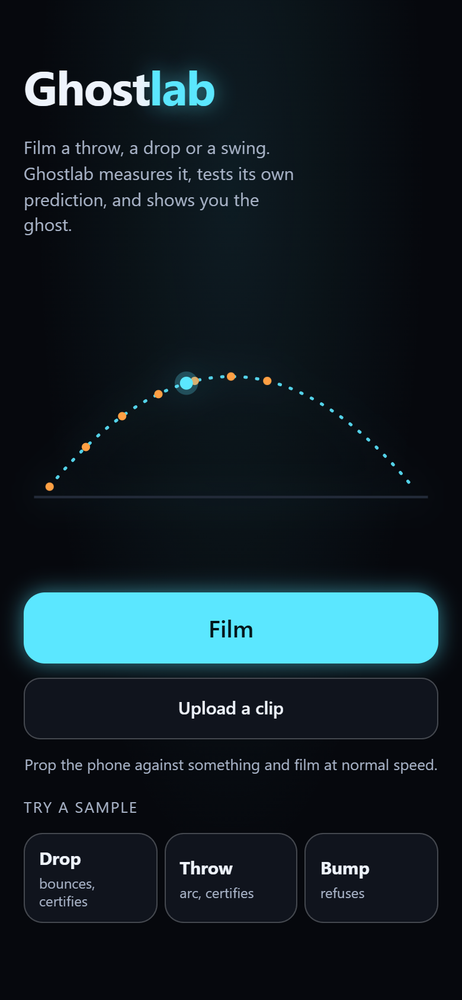
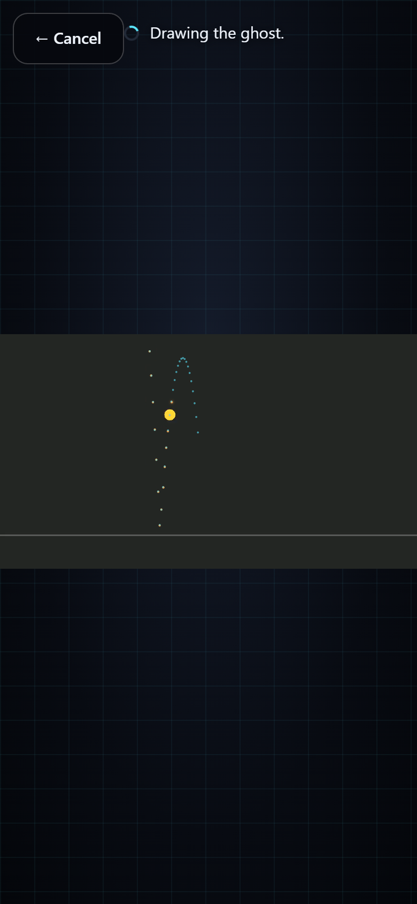
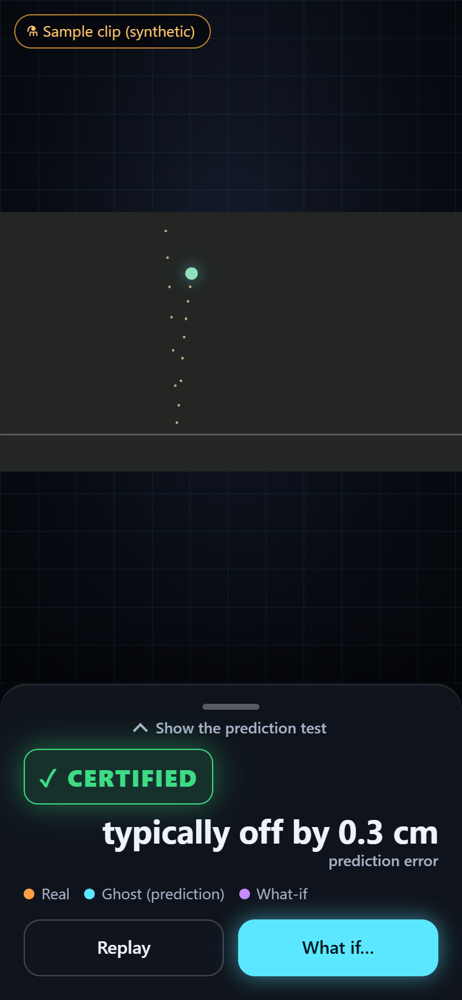
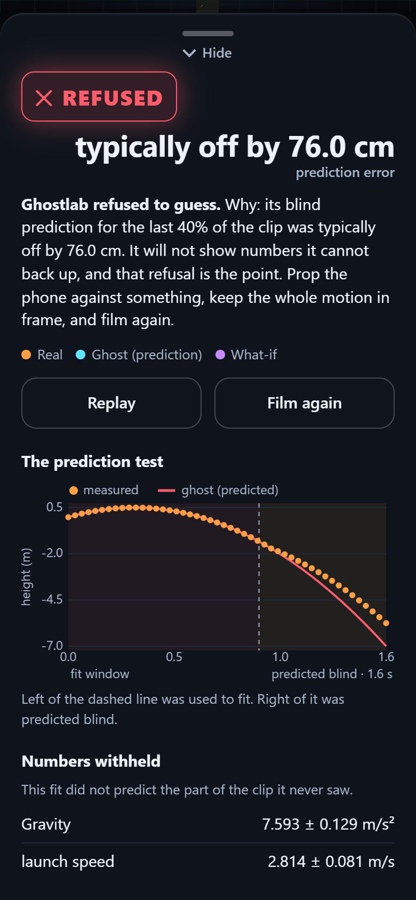
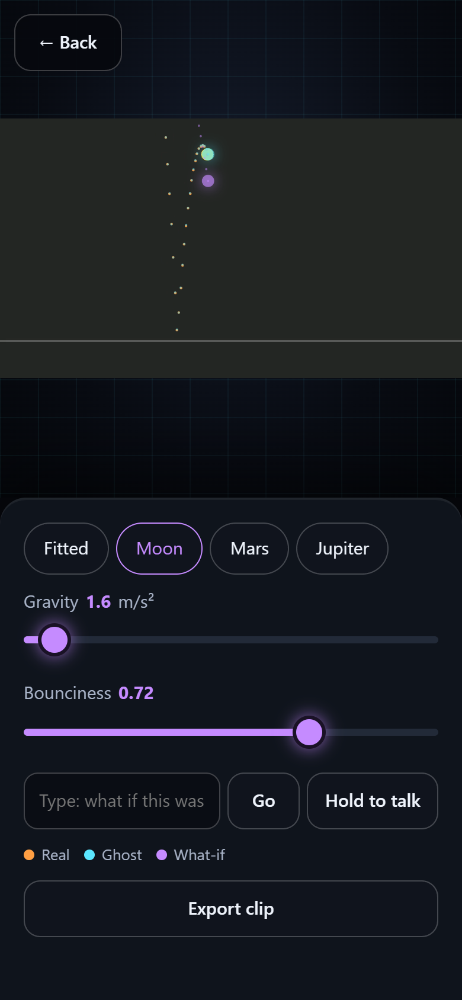

# Ghostlab

Film something moving on your phone. Ghostlab tracks it, fits the physics, and then **tests its own
model on footage it never saw**. If the prediction holds, you get a certified physics twin you can play
what-ifs on (Moon gravity, a bouncier ball). If it does not hold, Ghostlab refuses to show numbers.

Built for the Meta Global AI Developer Hackathon, Push the Frontier track.

Demo video: _link added at submission_. Repository: https://github.com/Provokke/ghostlab

<p>





</p>

Screens at 390x844 from `scripts/ui_check.py`, using the bundled synthetic sample clips (not filmed footage).

**Colour language:** orange = the real tracked path, cyan = the ghost (fitted model), purple = a what-if,
green = CERTIFIED, red = REFUSED.

## How it works

1. **Muse Spark** reads key frames and names the object, its real size and the motion type. It never produces a measurement.
2. **SAM 3.1** tracks the object through the whole clip (one box per frame).
3. Pixels become metres from the object's real size; least squares fits projectile, bounce, pendulum and ramp models, each with error bars.
4. **Held-out check:** fit on the first 60% of the clip, predict the last 40%, score against the real track. Certified or refused.
5. **Muse Voice Transcribe** turns a spoken what-if ("what if this was on the moon?") into text; keywords map it to gravity or bounciness.
6. The phone web app draws the twin as a ghost over the real video and re-simulates under what-if physics.

### The phone app

A dark, five-screen flow, 390 px wide first: **Capture** (Film, Upload, sample clips) -> **Analysing** (the clip plays, the real
path draws in orange, then the cyan ghost) -> **Confirm** (check the object's size before any verdict) -> **Verdict**
(CERTIFIED or REFUSED, "off by N cm", a drag-up sheet with the prediction-test chart and numbers) -> **Playground**
(Moon / Mars / Jupiter, gravity and bounciness sliders, hold-to-talk what-ifs, export the replay as a clip).
Sample clips skip Confirm and are tagged "Sample clip (synthetic)". A refused fit never opens the Playground.

Front end: vanilla ES modules in `web/js/` (`screens.js` state machine, `ghost.js` canvas, one module per screen, `api.js`,
`voice.js`, `export.js`), design tokens on `:root` in `web/style.css`. No build step.
Backend flow: `POST /api/identify` (store clip, Muse Spark guess) then `POST /api/analyze` with `{id, size_m}`; answers are
cached, so correcting the size is a cheap local re-fit.

## Quickstart (no key)

Requirements: Python 3.11 or later. ffmpeg is bundled through `imageio-ffmpeg`. Uploads are capped at 150 MB.

```
python -m venv .venv
# Windows: .venv\Scripts\activate      macOS/Linux: source .venv/bin/activate
pip install -e ".[dev]"        # ".[web]" is enough to only run the server
pytest -q
uvicorn ghostlab.server:app --port 8791
```

Open http://localhost:8791 and tap a sample clip. With no key the app serves the bundled synthetic demos; Film, Upload and
live voice need `MODEL_API_KEY` (Meta Model API key: `export MODEL_API_KEY=...`, or `$env:MODEL_API_KEY="..."` in PowerShell).
Docker: `docker build -t ghostlab .` then `docker run -p 8791:8080 -e MODEL_API_KEY ghostlab` (the image listens on 8080) (see `Dockerfile`).

Optional: `scripts/ui_check.py` (headless browser walk of all five screens) drives installed Microsoft Edge and needs `pip install ".[ui]"`; `scripts/webkit_check.py` needs `playwright install webkit`.
`scripts/make_demos.py` regenerates the bundled synthetic demos (tagged 6.7 cm); `scripts/render_clips.py` renders the 10 cm test clips used in Results into `work/render/` (gitignored, regenerate locally).

**Phones:** the camera and microphone need HTTPS (or localhost). Over plain HTTP on a LAN the browser blocks them and the app
shows "Microphone unavailable"; use `scripts/run_phone.ps1` (self-signed HTTPS; test steps in `docs/PHONE_TESTING.md`) or any HTTPS tunnel or deploy.

## Verified on

| Flow | Verified |
|---|---|
| All five screens, sample clips, certify/refuse | Headless Edge at 390x844 (`scripts/ui_check.py`); Playwright WebKit (`scripts/webkit_check.py`) |
| Live pipeline (SAM 3.1, Muse Spark, Voice Transcribe) | Run end to end on 2026-11-02 (below) |
| Mic what-ifs and clip export on iPhone Safari | Not verified. Known limitation: Safari MediaRecorder support; desktop Edge/Chrome is the tested path |

Keyboard-only and reduced-motion runs and a Lighthouse mobile audit are on the pre-submit checklist, not claimed here.

## Results

Rendered clips (not filmed) with known physics, made by `scripts/render_clips.py` and run end to end against the live Meta API with a 10 cm ball:

| Clip | Expected | Result |
|---|---|---|
| bounce (restitution 0.75) | certify | certified: e 0.748, held-out error 0.8 cm |
| pendulum (period 2.006 s) | certify | certified: period 2.027 s (1% off) |
| toss | certify | certified: g 8.93 (9% off, motion blur) |
| camera shake | refuse | refused: camera moved |
| slow motion (1/3 speed) | refuse | refused: under one swing, g reads 1.13 |

No real filmed clip has been certified; free real clips I tried were all refused, none certified wrongly.

## What was built during the hackathon

Everything in this repository was written during the building period (the design docs under
first commit 2026-10-25).

## Accuracy (synthetic)

`docs/benchmark.md`: median g error is 0.0 to 1.3% under noise and dropped frames (the noisiest bounce rows certify 85-95% of good clips), and the held-out check refused 100% of clips with an unmodelled late push (0% false certifications). This is synthetic data; the real-clip scoreboard comes from `python -m ghostlab scoreboard`.

## Licence

MIT, see `LICENSE`. Submission text: `docs/SUBMISSION.md`.
